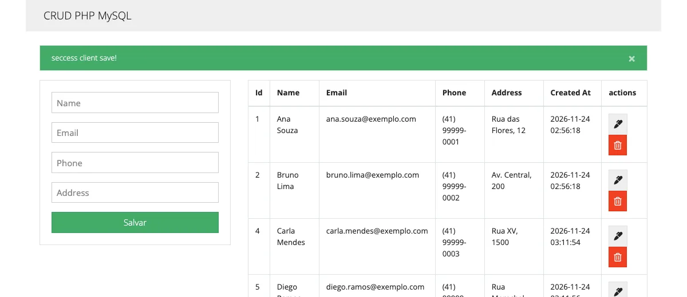
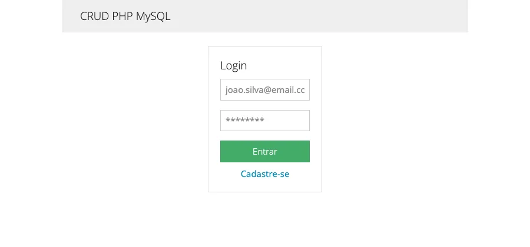
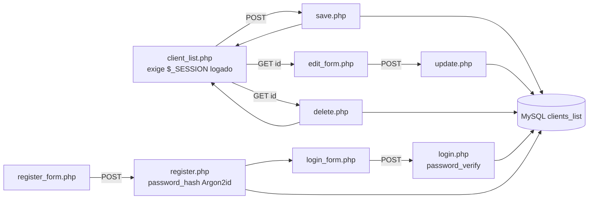
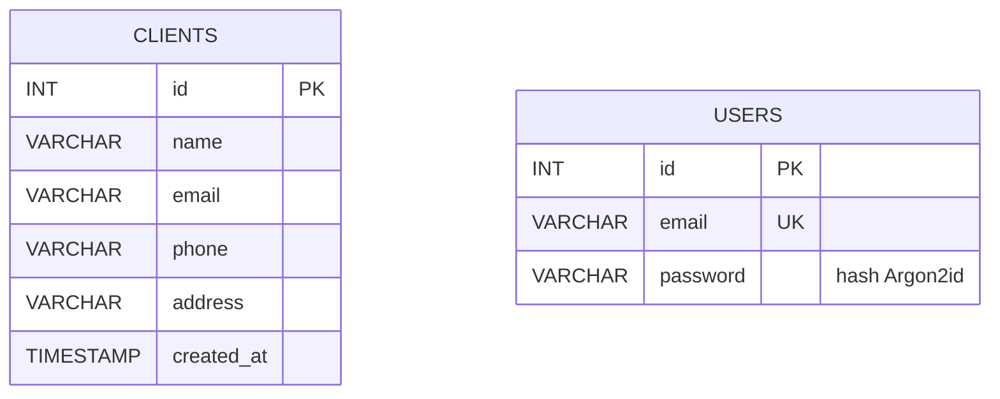

# CRUD dos Famosos (PHP + MySQL)

Cadastro de clientes (nome, e-mail, telefone e endereço) em PHP puro com `mysqli`, com tela de login e cadastro de usuário. Projeto de estudo para praticar CRUD, sessões e hash de senha.



| Login | |
|---|---|
|  | Dados fictícios. Prints feitos com `php -S` e um MySQL descartável em Docker. A lista só abre com a sessão marcada como logada (ver "Limitações conhecidas"), então o print foi feito com essa variável de sessão definida de fora do código. |

## Funcionalidades

- Criar, listar (os 10 primeiros), editar e excluir clientes.
- Mensagem de sucesso por sessão, que some sozinha depois de 2 segundos.
- Cadastro de usuário com senha guardada como hash Argon2id (`password_hash`) e login com `password_verify`.
- Logout (`session_unset` + `session_destroy`).

## Como funciona





O repositório não trazia o script do banco. O [`docs/schema.sql`](docs/schema.sql) foi reconstruído a partir das queries do código; tamanhos de coluna são uma escolha razoável, não o original.

## Stack

PHP 8 (`mysqli`), MySQL, Bootstrap 4 (tema Bootswatch Yeti) e Font Awesome via CDN.

## Como rodar

Pré-requisitos: PHP 8 com `mysqli` e um MySQL.

1. Crie o banco: `mysql -u root -p < docs/schema.sql`
2. Confira a conexão em `db.php`. Ela está fixa no código: `localhost:3306`, usuário `root`, senha `root`, banco `clients_list`. Ajuste para o seu MySQL (não há variáveis de ambiente).
3. Suba o servidor na raiz do projeto e abra o login:

```bash
php -S localhost:8000
# http://localhost:8000/login_form.php
```

## Estrutura

```text
db.php                     conexão mysqli + session_start
login_form.php, login.php  login
register_form.php, register.php  cadastro de usuário
logout.php
client_list.php            lista + formulário de novo cliente
save.php, edit_form.php, update.php, delete.php  CRUD
models/client.php          esboço de classe, não usado
docs/schema.sql            esquema reconstruído
```

## Limitações conhecidas

Encontradas ao rodar o projeto (24/11/2026); o código não foi alterado:

- **O login nunca libera a lista.** `login.php` não grava `$_SESSION['logado']` e, com a senha certa, redireciona para `/tasks_list.php`, que não existe (404). Como `client_list.php` exige `$_SESSION['logado'] === true`, a lista volta sempre para o login.
- **Senha errada não mostra erro.** `login.php` manda `?success=0`, mas `login_form.php` não lê esse parâmetro.
- **Links quebrados para `index.php`.** O logo da navbar e o redirecionamento de `update.php` apontam para `index.php`, que não existe; a edição é salva, mas termina num 404.
- **SQL injection.** Todas as queries montam o SQL concatenando `$_POST`/`$_GET` direto na string. O caminho é usar prepared statements (`mysqli_prepare`).
- **XSS.** A lista e o formulário de edição imprimem os dados sem `htmlspecialchars`.
- **Exclusão por GET, sem confirmação.** Um link (ou um crawler) apaga o registro.
- `register.php` não trata e-mail repetido nem mostra erro se o `INSERT` falhar (página em branco).
- `models/client.php` declara a classe `Task` com métodos que chamam a si mesmos (recursão infinita se usados). Não é incluído em lugar nenhum.
- `db.php` traz usuário e senha do MySQL fixos no código (`root`/`root`, credencial padrão de desenvolvimento local).
